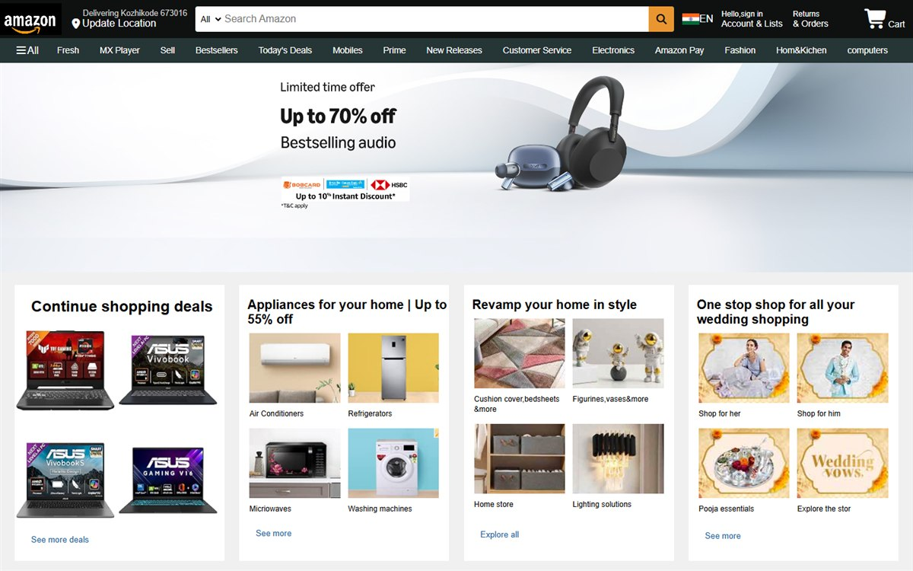

# Amazon Homepage Clone

[](https://akarshkv1234-glitch.github.io/amazon-clone/)
[](https://developer.mozilla.org/docs/Web/HTML)
[](https://developer.mozilla.org/docs/Web/CSS)



A front-end recreation of the Amazon homepage, built to practice responsive
layouts, navigation and component styling with plain HTML and CSS.

**Live demo:** https://akarshkv1234-glitch.github.io/amazon-clone/

## Features

- Header with logo, delivery location, search bar and account links
- Category navigation
- Hero section and product category cards
- Multi-column footer
- Responsive layout for smaller screens

## Built with

- HTML5
- CSS3
- Font Awesome

## Run locally

Open `index.html` in a browser, or serve the folder:

```bash
python -m http.server 8000
```

## Note

This is an educational front-end clone. It is not affiliated with or endorsed
by Amazon. All trademarks belong to their respective owners.
